<div align="center">



[](https://factiii.com/user/jon)
[](https://www.linkedin.com/in/jonathan-snyder-b37b0598/)
[](https://factiii.com)

</div>

```text
> whoami
  Full-stack engineer. Founder of Factiii.
  U.S. Air Force officer. Physics nerd.
  B.S. Physics (UT Austin) · M.A. Economics (Oklahoma)
```

## 🛰️ Systems in Production

Products I founded and lead, from architecture to on-call:

| System | What it does | Interesting parts |
|---|---|---|
| **[Factiii](https://factiii.com)** | Social platform on web, iOS and Android | 3D globe on Cesium/WebGL, WebRTC peer-to-peer sync, offline-first mobile, real-time Socket.io, LLM bots with tool calling |
| **[GreaseMoto](https://greasemoto.com)** | Motorcycle parts store, 150K+ SKUs | Full-text search across the catalog, Stripe webhooks with idempotent processing, USPS address and rate APIs |
| **[Link3D](https://link3d.io)** | Tap-to-connect social network | Native NFC read/write in React Native, real-time messaging |
| **[TapTrack](https://taptrack.io)** | NFC time tracking and payroll | Gusto OAuth payroll sync, role-based access, tour management |

All four are end-to-end type-safe TypeScript monorepos: tRPC + Zod contracts shared from server to web to mobile, Prisma on PostgreSQL, Turborepo + pnpm.

<div align="center">

[](https://app.deepsource.com/gh/jsnyder10/factiii/)
[](https://app.deepsource.com/gh/jsnyder10/Chop-Shop/)

</div>

## 🔧 Engineering Highlights

- **Real-time and offline-first.** WebRTC data channels for device-to-device sync (signaling, ICE candidate buffering), with a local SQLite store on mobile that keeps working with no network.
- **3D on the web.** A Cesium globe renderer with custom imagery providers, terrain and OSM buildings.
- **Hardware at the edge.** Native NFC tag reading and writing on iOS and Android.
- **Money and logistics.** Stripe subscriptions, refunds and invoices; USPS OAuth, address verification and ZIP+4; Gusto payroll over OAuth 2.0.
- **Ops.** Docker multi-stage builds, Nginx + Certbot, AWS, CI/CD for web, server and mobile, OTA updates for the mobile apps, integration tests with Jest + Supertest.

## 🧰 Stack


## 📡 Find Me

[LinkedIn](https://www.linkedin.com/in/jonathan-snyder-b37b0598/) · [Factiii](https://factiii.com/user/jon)


